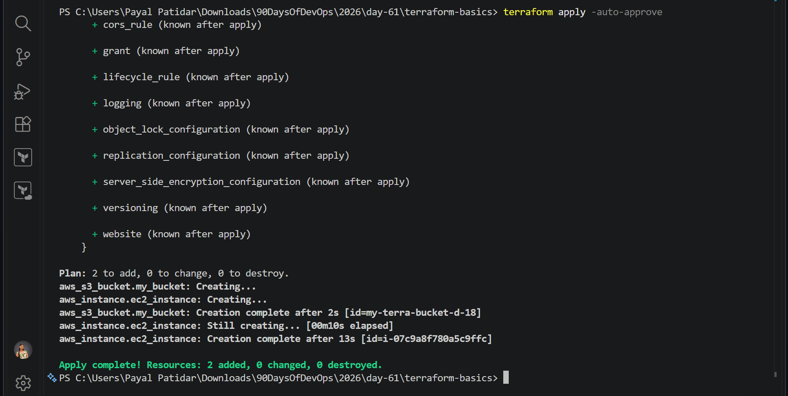
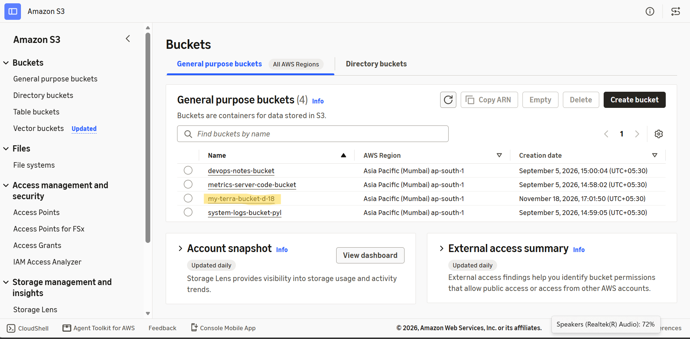
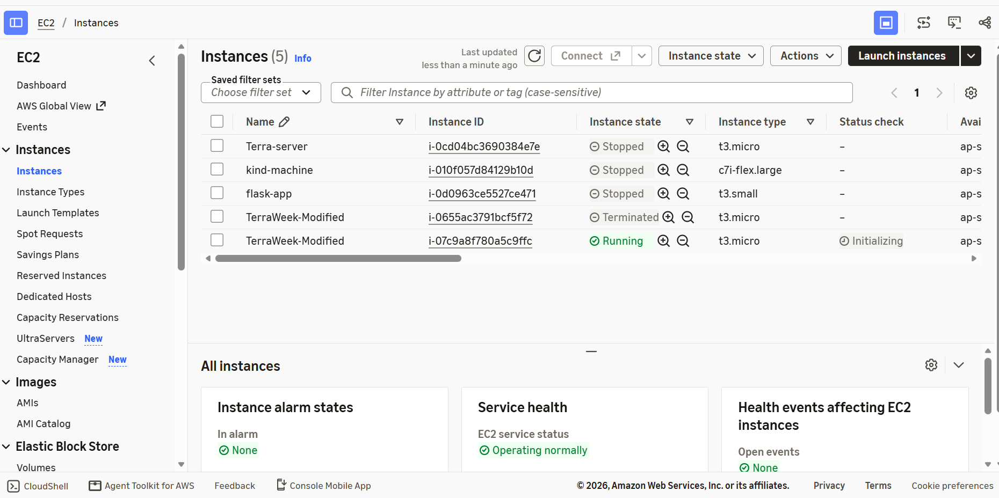

# Scenario Based Questions 
## Task 1

## Q1. What is Infrastructure as Code(Iac)? Why does it matter in DevOps?

Infrasturcture as code(Iac) is a practice of provisioning and managing infrastructure via a code like configuration file instead of creating resources manually.  
  
Terraform is one of populer tool which allows us to write configuration code in HCL.

In Devops, Iac is important because manually creating resources and servers takes too much time and can introduce human errors. With Iac, we can automate infrastructure provisioning, maintain consistency and easy produce environment.

## Q2. What problem Iac solve compared to maunal creating resources in AWS console?

When we create AWS resources manually throught AWS console, it takes more time, and there is a possibility of human error or configuration difference. 

Iac solve these problems by allowing us to define infrastructure in configuration files. we can reuse the same configuration to create, update or destroy resources. 

It also provides version control, automation, consistency, and repeatability.

## Q3. How is Terrafrom different form CloudFromation, Ansible and Pulumi?

- Terraform is multi-cloud Iac tool that uses HCL for provisioning and managing infrasturcture.

- CloudFromation is an AWS-native Iac service that is primarily used for AWS resources provisioning.

- Ansible is mainly used for insfrastucture management, system installtion, and automation task. Is is also capable for provisioning infrastructure.

- Pulumi is an Iac tool that allows developers to define infrastucture using general perpose programming language such as Python, Go, TypeScript.


## Q4. What doed it means that Terraform is 'declarative' and 'cloud-agnostic' ?

Terraform is declarative because we define the desired state of our infrastucture in configiration file and terraform determines the actions required to achieve that state.

Terraform is also Cloud-agnostic because it supports multiple cloud providers such as AWS, Azure, GCP through different providers.


## Task 2
## Install Terraform and Configure AWS
1. Install terraform:
```bash
# Linux(ubuntu)
wget -O - https://apt.releases.hashicorp.com/gpg | sudo gpg --dearmor -o /usr/share/keyrings/hashicorp-archive-keyring.gpg

echo "deb [arch=$(dpkg --print-architecture) signed-by=/usr/share/keyrings/hashicorp-archive-keyring.gpg] https://apt.releases.hashicorp.com $(grep -oP '(?<=UBUNTU_CODENAME=).*' /etc/os-release || lsb_release -cs) main" | sudo tee /etc/apt/sources.list.d/hashicorp.list

sudo apt update && sudo apt install terraform

# MacOS
brew tap hashicorp/tap
brew install hashicorp/tap/terraform

# Windows
choco install terraform
```
2. Verify:
```bash
terraform --version
```
3. Install and configure AWS CLI:
```bash
- AWS CLI Install
# linux
curl "https://awscli.amazonaws.com/awscli-exe-linux-x86_64.zip" -o "awscliv2.zip"
unzip awscliv2.zip
sudo ./aws/install

- configure aws cli
aws configure
# Enter your Access Key ID, Secret Access Key, default region (e.g., ap-south-1), output format (json)
```

## Task 3
## Write First Configuration -- S3 Bucket Create

## Q. What did terraform init download? What does the .terraform/ directory contain?

When we run ```terraform init```, Terraform initializes the working directory and downloads the required provider plugins and modules specified in the Terraform configuration.

The .terraform/ directory stores downloaded providers, modules, and internal metadata required by Terraform.

Terraform also creates .terraform.lock.hcl, which locks provider versions and checksums to maintain consistency across environments.


## Task 4
## Create EC2 Instance

## Q. How does Terraform know the S3 bucket already exists and only the EC2 instance needs to be created?

Terraform determines what already exists and what needs to be created by comparing three things:
1) Terraform Configuration (.tf files): What infrastructure do we want?
2) Terraform State (terraform.tfstate): What infrastructure does Terraform currently track?
3) Real Infrastructure (AWS): What actually exists in AWS?

Terraform uses its configuration files and state file to understand the desired and currently tracked infrastructure. During terraform plan, it refreshes the tracked resource information from the cloud provider and compares it with the configuration. Based on the differences, Terraform determines which resources need to be created, updated, or destroyed.





## Task 5
## Understand the State files
Terraform tracks everything it creates in a state file. Time to inspect it.
## Q. What information does the state file store about each resource?

The Terraform state file stores information about the infrastructure managed by Terraform, including resource types, resource names, unique resource IDs, provider details, resource attributes, and dependency information. Terraform uses this state to map configuration files to actual infrastructure and determine what changes are required.

## Q. Why should you never manually edit the state file?
The Terraform state file (terraform.tfstate) contains information about the infrastructure resources managed by Terraform.

We should avoid manually editing it because even a small incorrect change can create inconsistencies between Terraform's state and actual cloud infrastructure.

Main reasons

1. State corruption: Incorrect changes in the JSON structure can make the state file invalid or unusable.
2. Infrastructure mismatch: If you change resource IDs or attributes incorrectly, Terraform may lose the correct mapping between configuration and real AWS resources.
3. Unexpected changes: Terraform might propose creating, modifying, or deleting resources unexpectedly.
4. Dependency issues: Incorrect modifications can affect relationships between resources.
5. Sensitive information: State files may contain passwords, secrets, and other confidential information.

## Q. Why should the Terraform state file not be committed to Git?

The Terraform state file (terraform.tfstate) should not be committed to Git because it may contain sensitive infrastructure information.

Main reasons

1. Sensitive information exposure: It may contain passwords, secret keys, API tokens, and credentials.
2. State conflicts: Multiple team members may end up working with different state versions, causing inconsistencies.
3. Version control issues: State files change frequently, creating unnecessary Git history.
4. Infrastructure information exposure: It may reveal resource IDs, IP addresses, and infrastructure details.

## Task 6
## Modify Plan and Destroy 

```terraform destroy``` is used to destroy all infrastructure resources managed by the current Terraform configuration and state.