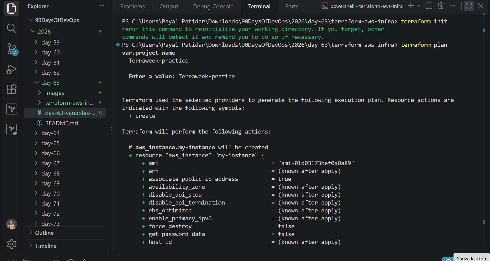
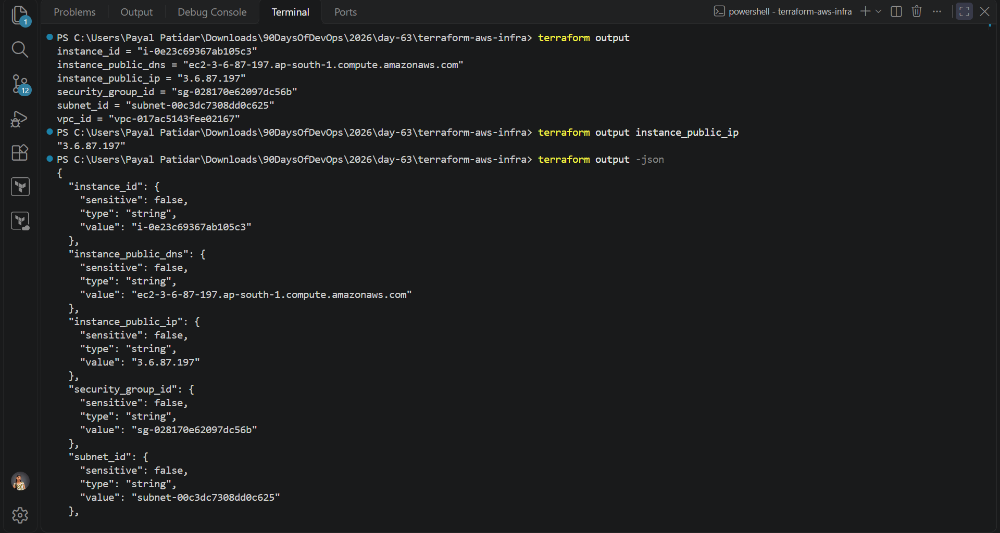

# Day 63 -- Variables, Outputs, Data Sources and Expressions

## Challenge Tasks

## Task 1: Extract Variables
1. Create a `variables.tf` file with input variables for:

- region (string, default: your preferred region)
- vpc_cidr (string, default: "10.0.0.0/16")
- subnet_cidr (string, default: "10.0.1.0/24")
- instance_type (string, default: "t2.micro")
- project_name (string, no default -- force the user to provide it)
- environment (string, default: "dev")
- allowed_ports (list of numbers, default: [22, 80, 443])
- extra_tags (map of strings, default: {})

2. Replace every hardcoded value in `main.tf` with `var.<name>` references
3. Run terraform plan -- it should prompt you for project_name since it has no default



### Q. What are the five variable types in Terraform? (string, number, bool, list, map)
Five variable types in Terraform

1. String: Used to store text values. 
Example: "dev"
2. Number: Used to store numeric values(integers and decimal). 
Example: 2
3. Bool: Used to store Boolean values like true or false.
Example: true
4. List: Used to store multiple values of same type in an orders collection.
Example: type = list(number), default = [22, 80, 443]
5. Map: Used to store multipe key-value pairs. Each value much have the same type.
Example: type = map(string), default = {Owner = "DevOps"  Environment = "Development"}

## Task 2: Variable Files and Precedence

1. Create terraform.tfvars:
project_name = "terraweek"
environment  = "dev"
instance_type = "t2.micro"

2. Create prod.tfvars:
project_name = "terraweek"
environment  = "prod"
instance_type = "t3.small"
vpc_cidr     = "10.1.0.0/16"
subnet_cidr  = "10.1.1.0/24"

3. Apply with the default file:
terraform plan                              # Uses terraform.tfvars automatically

4. Apply with the prod file:
terraform plan -var-file="prod.tfvars"      # Uses prod.tfvars

5. Override with CLI:
terraform plan -var="instance_type=t2.nano"  # CLI overrides everything

6. Set an environment variable:
export TF_VAR_environment="staging"
terraform plan                              # env var overrides default but not tfvars

### Q Write the variable precedence order from lowest to highest priority.
Terraform variable precedence order from lowest to highest priority:

1. Default values defined in variable blocks.
2. terraform.tfvars file.
3. *.auto.tfvars files (alphabetical order).
4. -var and -var-file command-line options (in command-line order; later values override earlier ones).
5. Environment variables (TF_VAR_name).

Remember: If the same variable gets multiple values, Terraform uses the value with the highest precedence.

## Task 3: Add Outputs
Create an outputs.tf file with outputs for:

vpc_id -- the VPC ID
subnet_id -- the public subnet ID
instance_id -- the EC2 instance ID
instance_public_ip -- the public IP of the EC2 instance
instance_public_dns -- the public DNS name
security_group_id -- the security group ID

Apply your config and verify the outputs are printed at the end:



## Task 4: Use Data Sources
Stop hardcoding the AMI ID. Use a data source to fetch it dynamically.

1. Add a data "aws_ami" block that:

- Filters for Amazon Linux 2 images
- Filters for hvm virtualization and gp2 root device
- Uses owners = ["amazon"]
- Sets most_recent = true

2. Replace the hardcoded AMI in your aws_instance with data.aws_ami.amazon_linux.id

3. Add a data "aws_availability_zones" block to fetch available AZs in your region

4. Use the first AZ in your subnet: data.aws_availability_zones.available.names[0]


### Q What is the difference between a resource and a data source?

- Resource: Used to create, update, and manage infrastructure.
- Data Source: Used to fetch information about existing infrastructure or external resources.

## Task 5: Use Locals for Dynamic Values
The locals block is used to define reusable values or expressions once and use them in multiple places in our Terraform configuration.

**Syntax:**
```hcl
locals {
  project_name = "bankapp"
  environment  = "dev"
  name         = "${local.project_name}-${local.environment}"
}
```

**How to use:**

```hcl
resource "aws_instance" "web" {
  tags = {
    Name        = local.name
    Project     = local.project_name
    Environment = local.environment
  }
}
```

**Why use Locals?**
- Avoid repeating values.
- Reuse common values across resources.
- Create dynamic names and tags.
- Keep Terraform code clean and maintainable.

**Remember:**
- Define values using `locals { }`.
- Access values using `local.value_name`.
- Variables accept external inputs; locals define reusable values inside Terraform.

## Task 6 Built-in Functions and Conditional Expressions
Terraform provides ready-made functions to perform operations on values.

1. String functions:

- upper("terraweek") -> "TERRAWEEK"
- join("-", ["terra", "week", "2026"]) -> "terra-week-2026"
- format("arn:aws:s3:::%s", "my-bucket")

2. Collection functions:

- length(["a", "b", "c"]) -> 3
- lookup({dev = "t2.micro", prod = "t3.small"}, "dev") -> "t2.micro"
- toset(["a", "b", "a"]) -> removes duplicates

3. Networking function:

- cidrsubnet("10.0.0.0/16", 8, 1) -> "10.0.1.0/24"

4. Conditional expression

`instance_type = var.environment == "prod" ? "t3.small" : "t2.micro" `

### Q. The difference between variable, local, output, and data

```
Block	    Purpose	                                                        Reference syntax
variable	Accepts input values from users	                                var.name
locals	    Defines reusable values inside configuration	                local.name
output	    Displays or exposes values after execution	                    output name
data	    Fetches information about existing resources or external data	data.type.name.attribute
```