# Day 64 -- Terraform State Management and Remote Backends

## Challenge Tasks

### WHY – Why does Terraform need State Management?

After provisioning infrastructure, Terraform also needs to maintain a record of the resources it manages.

For example, it needs to know:
- Which resources were created by Terraform?
- What are their resource IDs and attributes?
- How are different resources connected?
- Which resources need to be updated or destroyed?

Without this information, Terraform would struggle to track and manage previously created infrastructure.

**Therefore, Terraform uses a State File (`terraform.tfstate`) to maintain resource information and manage infrastructure throughout its lifecycle.**

Terraform State File (terraform.tfstate) is a file that stores information about the infrastructure provisioned and managed by Terraform.

### WHAT – What is Terraform State Management?
Terraform State Management is the process of tracking, storing, and maintaining information about infrastructure resources managed by Terraform.

## Task 1:  Inspect Your Current State
Use Day 63 config. Apply it and then explore the state:

```bash
terraform show                                    # Full state in human-readable format
terraform state list                              # All resources tracked by Terraform
terraform state show aws_instance.<name>          # Every attribute of the instance
terraform state show aws_vpc.<name>               # Every attribute of the VPC
```
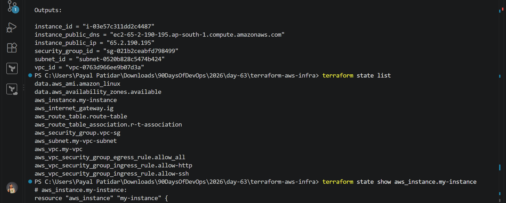

### Q.1 How many resources does Terraform track?
Terraform State tracks all resources managed by Terraform, along with the data source information recorded in the state.

Example:
- 10 Managed Resources
- 2 Data Sources
Total: 12 objects recorded in Terraform State.

### Q.2 What attributes does the state store for an EC2 instance?

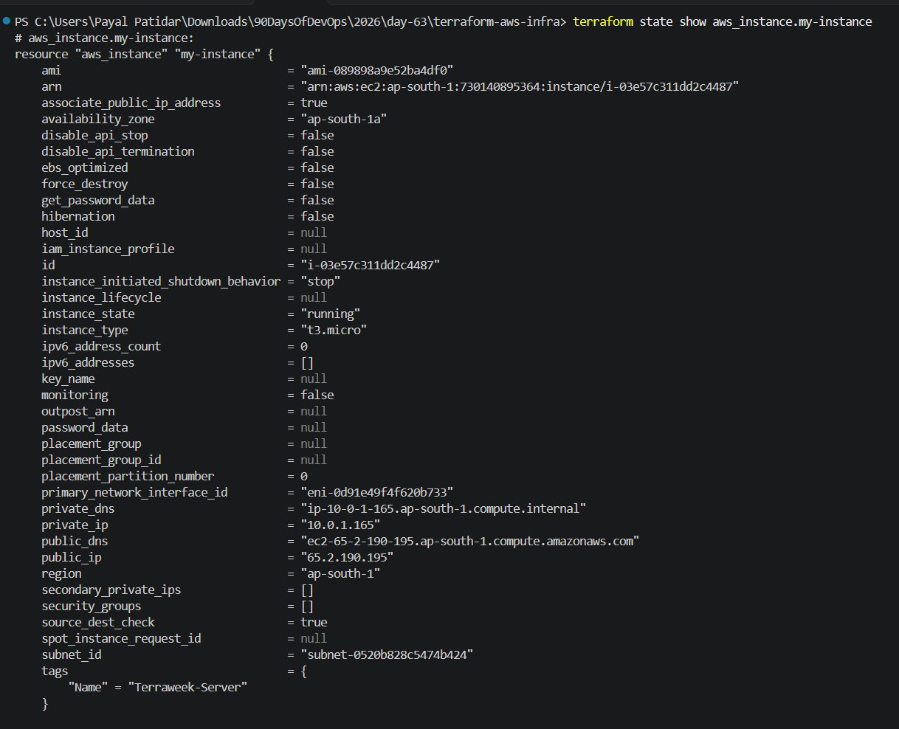
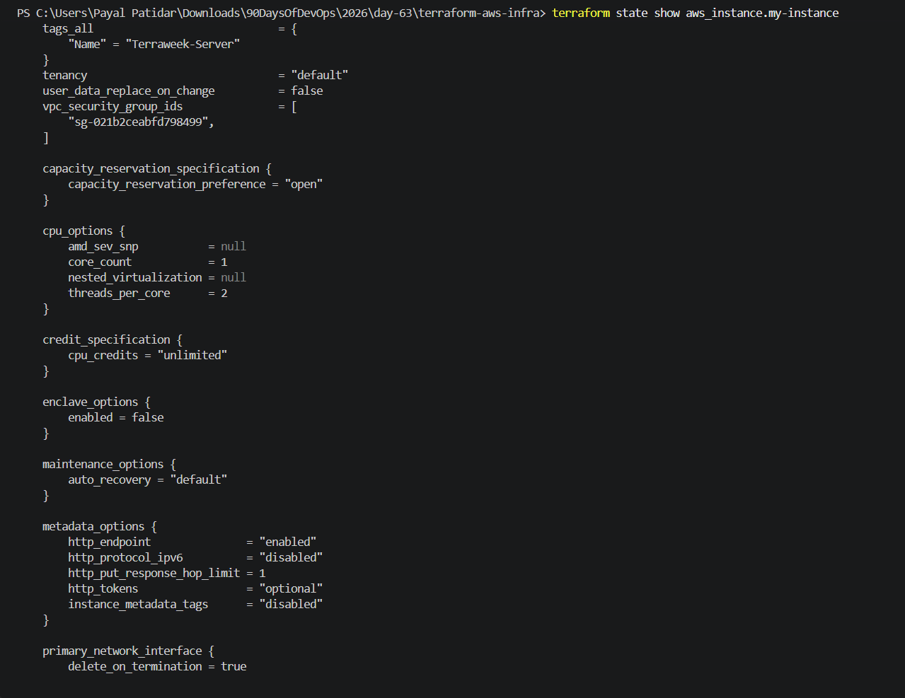
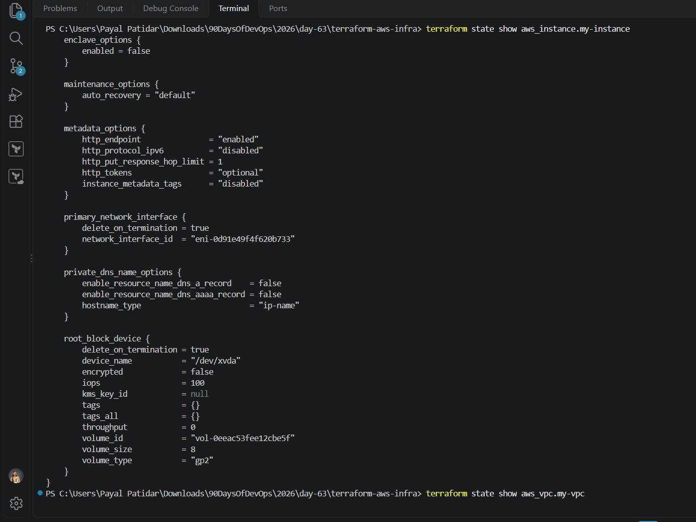

For an EC2 instance, these include its AMI ID, instance ID, ARN, instance type, availability zone, IP addresses, DNS names, network interface ID, instance state, and other configuration details.

### Q.3 Open terraform.tfstate in an editor -- find the serial number. What does it represent?
The serial number represents the version number of the Terraform State. It increases whenever Terraform successfully updates the state.

In my terraform.tfstate file, the serial number is 1, which indicates that the current state has serial version 1.

## Task 2: Set Up S3 Remote Backend

By default, Terraform stores its state file (terraform.tfstate) on the local machine.

Storing state locally is dangerous -- one deleted file and we lose everything. Time to move it to S3.

1. First, create the backend infrastructure (do this manually or in a separate Terraform config):

Setup S3 Remote Backend

To store Terraform state files remotely, we use AWS S3 and DynamoDB (traditional locking approach).

1. S3 Bucket – State File Storage
- Stores the Terraform state file (terraform.tfstate) remotely.
- Provides centralized state storage.
- Bucket versioning helps recover previous state versions.

2. DynamoDB – State Locking
- Prevents multiple users from modifying the Terraform state simultaneously.
- Maintains a lock record while Terraform performs state operations.
- Releases the lock after the operation completes.

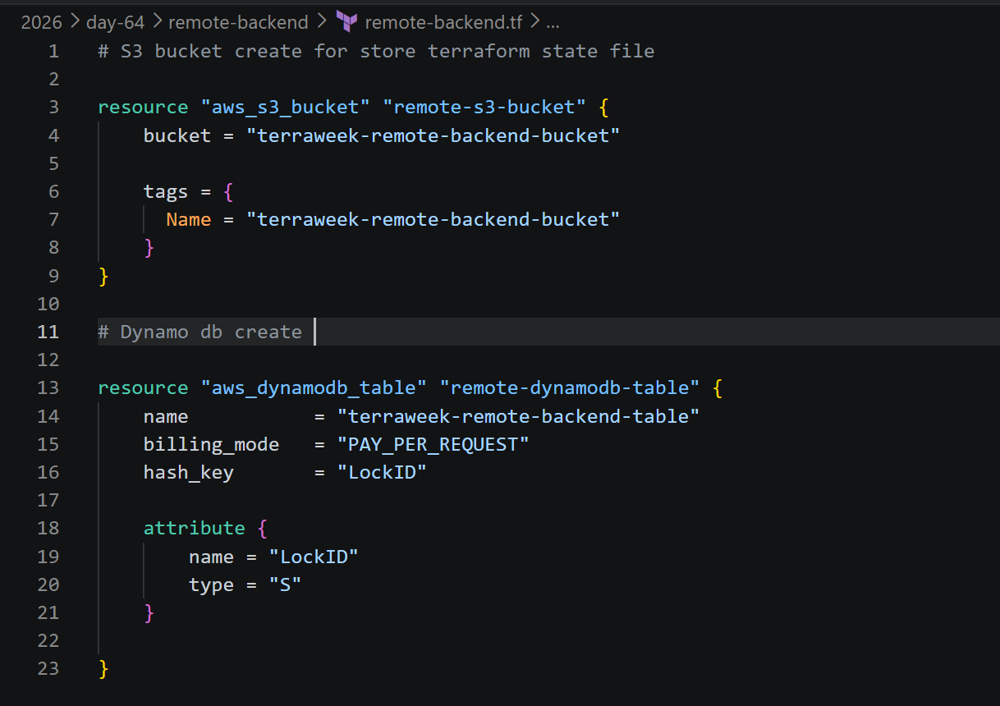

2. Add the backend block to our Terraform config:

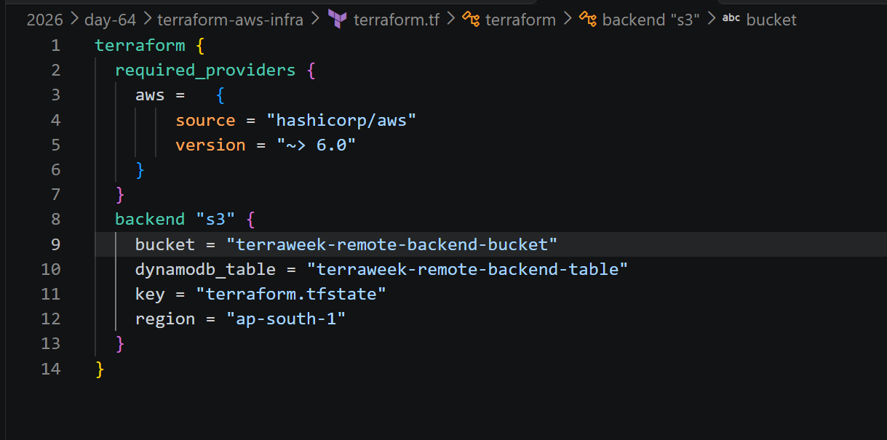

3. Initialize Remote Backend
`terraform init`

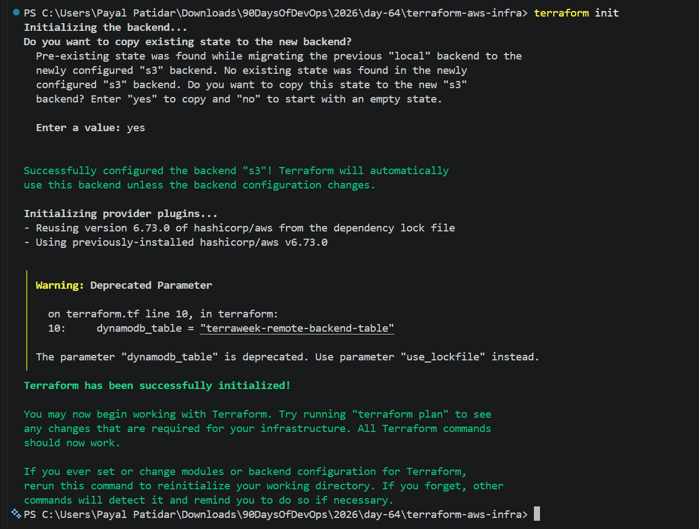

## Task 3: Test State Locking
State locking prevents two people from running terraform apply at the same time and corrupting the state.

1. Open two terminals in the same project directory
2. In Terminal 1, run:
terraform apply
3. While Terminal 1 is waiting for confirmation, in Terminal 2 run:
terraform plan
4. Terminal 2 should show a lock error with a Lock ID

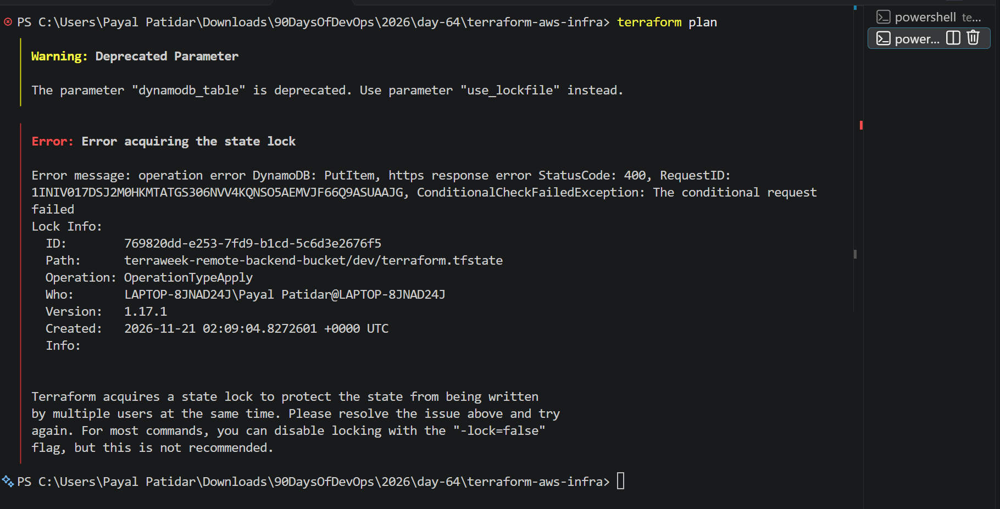

### Q. Why is locking critical for team environments?
When multiple team members work on the same Terraform infrastructure, they may try to run terraform apply simultaneously.

State locking prevents multiple users or processes from modifying the Terraform state file at the same time.

5. After the test, if you get stuck with a stale lock:
`terraform force-unlock <LOCK_ID>`

## Task 4: Import an Existing Resource
Not everything starts with Terraform. Sometimes resources already exist in AWS and you need to bring them under Terraform management.

1. Manually create an S3 bucket in the AWS console -- name it terraweek-import-test-04-bucket
2. Write a resource "aws_s3_bucket" block in your config for this bucket (just the bucket name, nothing else)

3. Import it:
`terraform import aws_s3_bucket.imported terraweek-import-test-04-bucket`

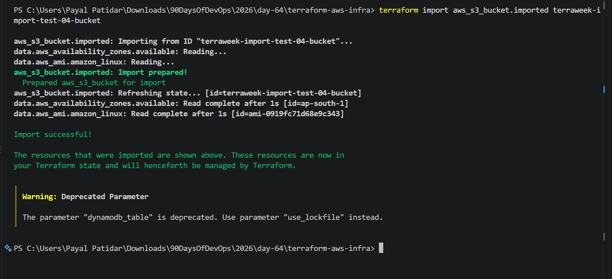

4. Run terraform plan:

- If you see "No changes" -- the import was perfect
- If you see changes -- your config does not match reality. Update your config to match, then plan again until you get "No changes"

5. Run terraform state list -- the imported bucket should now appear alongside your other resources

### Q. What is the difference between terraform import and creating a resource from scratch?
1. Terraform Import
- Used to bring an already existing AWS resource under Terraform management.
- Adds the resource information to the Terraform state file.
- Does not create new infrastructure.
- Requires an existing resource identifier.

2. Creating a Resource from Scratch
- Used to create new infrastructure through Terraform configuration.
- Terraform creates the resource using terraform apply.
- Automatically records the created resource in the state file.

## Task 5: State Surgery -- mv and rm
Sometimes you need to rename a resource or remove it from state without destroying it in AWS.

1. Rename a resource in state:
```hcl
terraform state list                              # Note the current resource names
terraform state mv aws_s3_bucket.imported aws_s3_bucket.logs_bucket
```
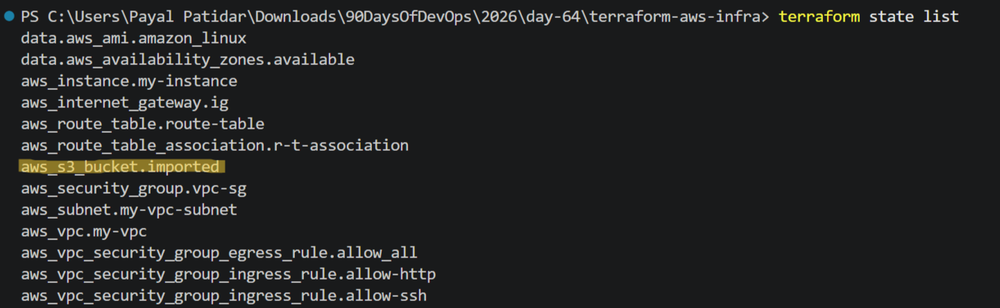

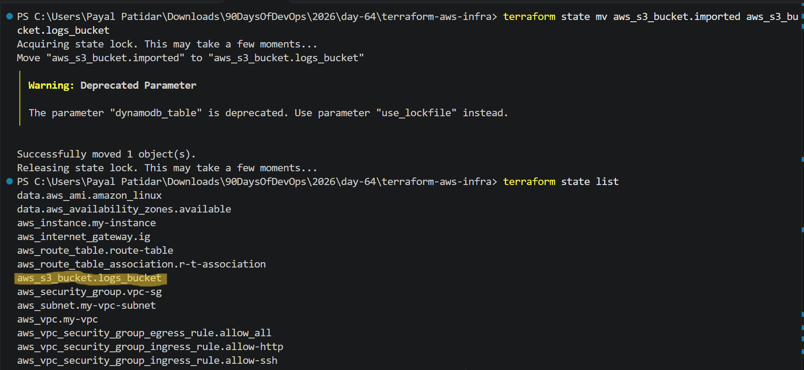

Update our main.tf file to match the new name. Run terraform plan -- it should show no changes.

2. Remove a resource from state (without destroying it):

``` hcl
terraform state rm aws_s3_bucket.logs_bucket
```

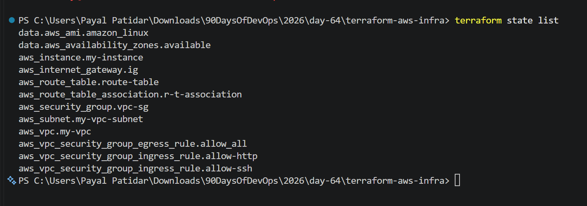

Run terraform plan -- Terraform no longer knows about the bucket, but it still exists in AWS.

3. Re-import it to bring it back:
```hcl
terraform import aws_s3_bucket.logs_bucket terraweek-import-test-<yourname>
```
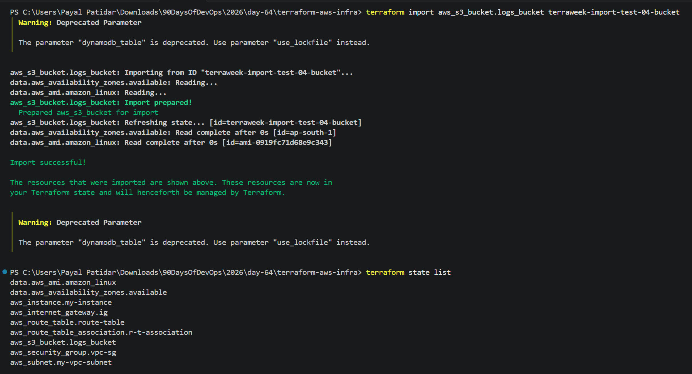

### Q. When would you use state mv in a real project? When would you use state rm?

- `terraform state mv` is used when you want to change the name or location of a resource in Terraform state without destroying and recreating the actual infrastructure.
- `terraform state rm` is used when you want to remove a resource from Terraform state without deleting the actual infrastructure.

## Task 6: Simulate and Fix State Drift

State drift happens when someone changes infrastructure outside of Terraform -- through the AWS console, CLI, or another tool.

1. Apply your full config so everything is in sync
2. Go to the AWS console and manually:
    - Change the Name tag of your EC2 instance to "ManuallyChanged"
    - Change the instance type if it's stopped (or add a new tag)

3. Run:
    `terraform plan`
You should see a diff -- Terraform detects that reality no longer matches the desired state.

4. You have two choices:

- Option A: Run terraform apply to force reality back to match your config (reconcile)
- Option B: Update your .tf files to match the manual change (accept the drift)

Choose Option A -- apply and verify the tags are restored.

Run terraform plan again -- it should show "No changes." Drift resolved.

### Q. How do teams prevent state drift in production? (hint: restrict console access, use CI/CD for all changes)
State drift occurs when the actual infrastructure differs from the configuration or Terraform state, often because someone manually changes resources outside Terraform.

Teams use the following practices to prevent state drift in production:

1. Restrict Console Access: Limit AWS Console access and permissions so developers cannot make unauthorized infrastructure changes manually.

2. Use CI/CD Pipelines: Make infrastructure changes through CI/CD pipelines using Terraform instead of manually modifying resources.

3. Remote State Backend: Store Terraform state in a centralized remote backend, such as AWS S3, so team members work with shared state.

4. Enable State Locking: Use state locking to prevent multiple team members or pipelines from modifying the state simultaneously.

5. Regular Drift Detection: Run terraform plan regularly to identify differences between the actual infrastructure and Terraform configuration.

6. Code Reviews: Require Pull Requests and approvals before applying infrastructure changes.

7. Audit Changes: Use AWS CloudTrail to track infrastructure changes and identify who made manual modifications.