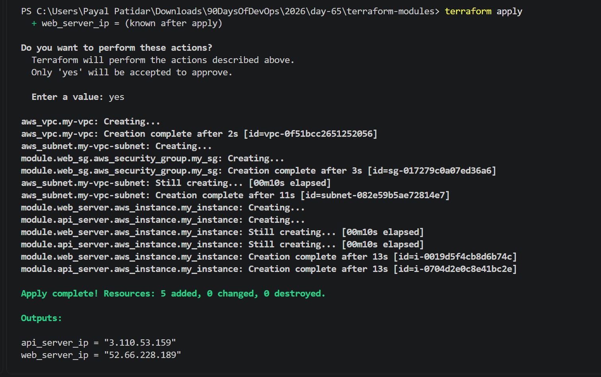
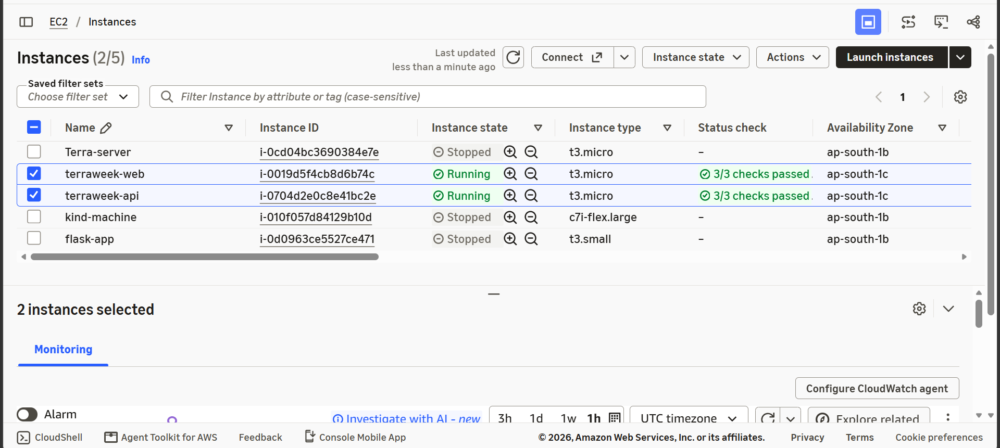
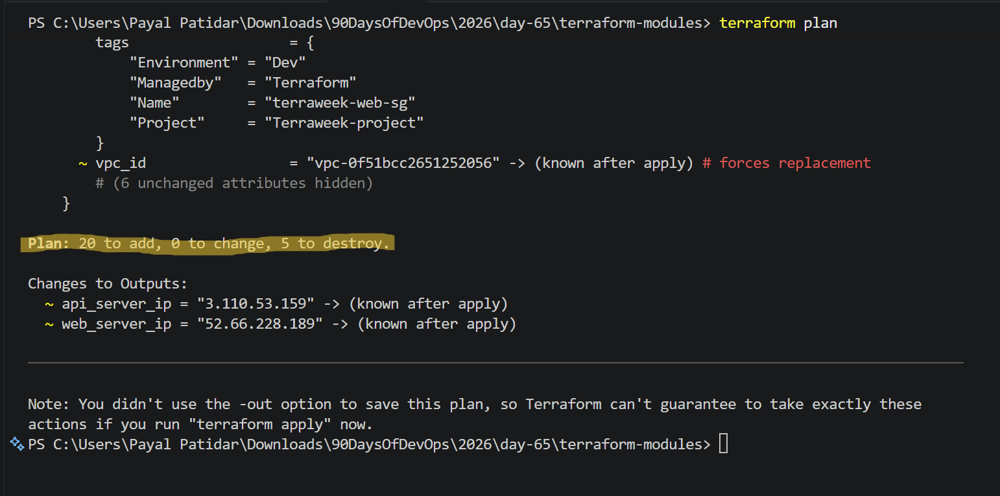
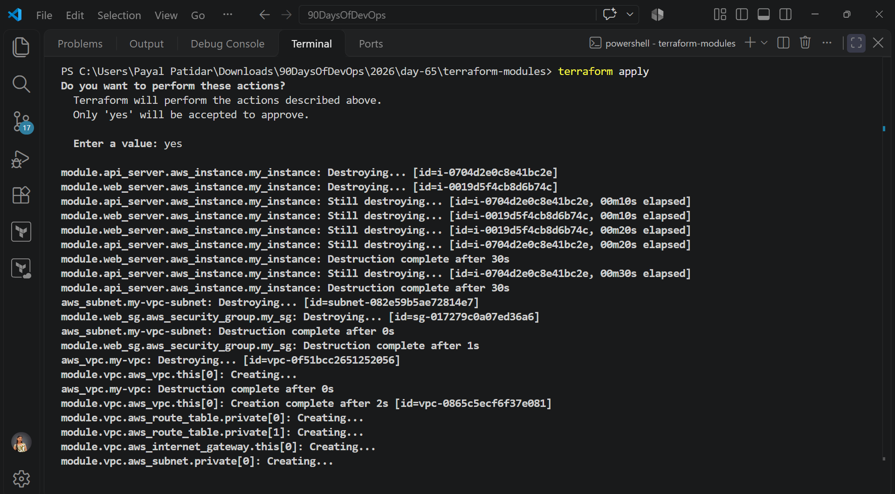
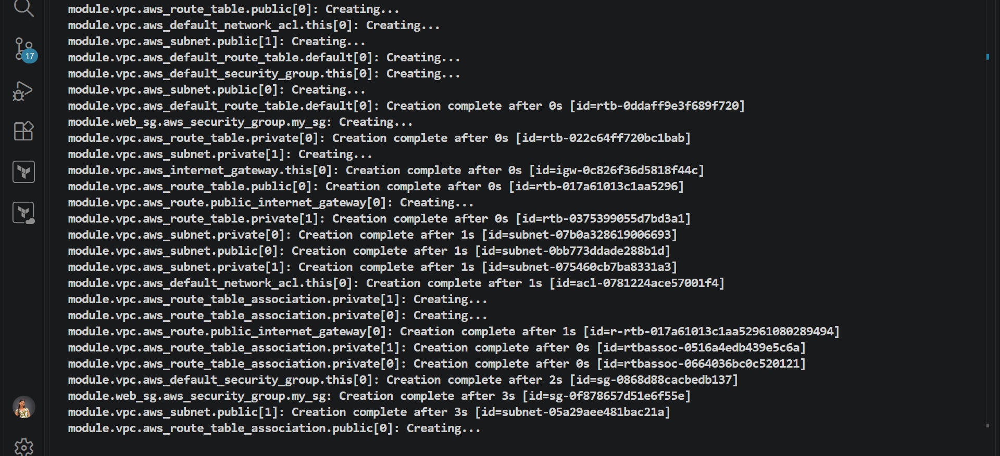
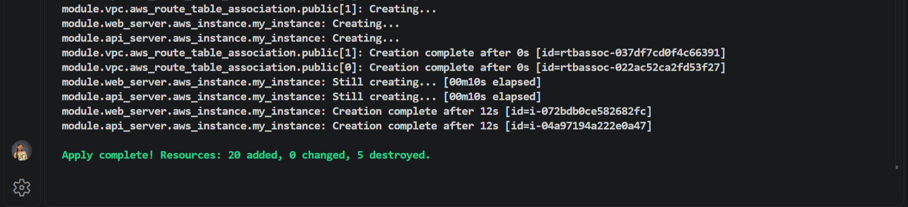
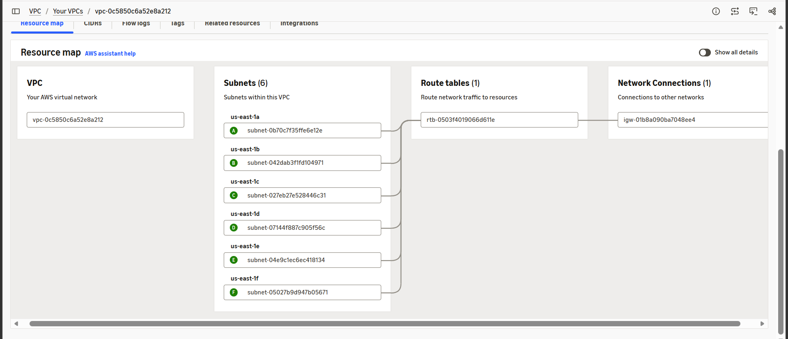
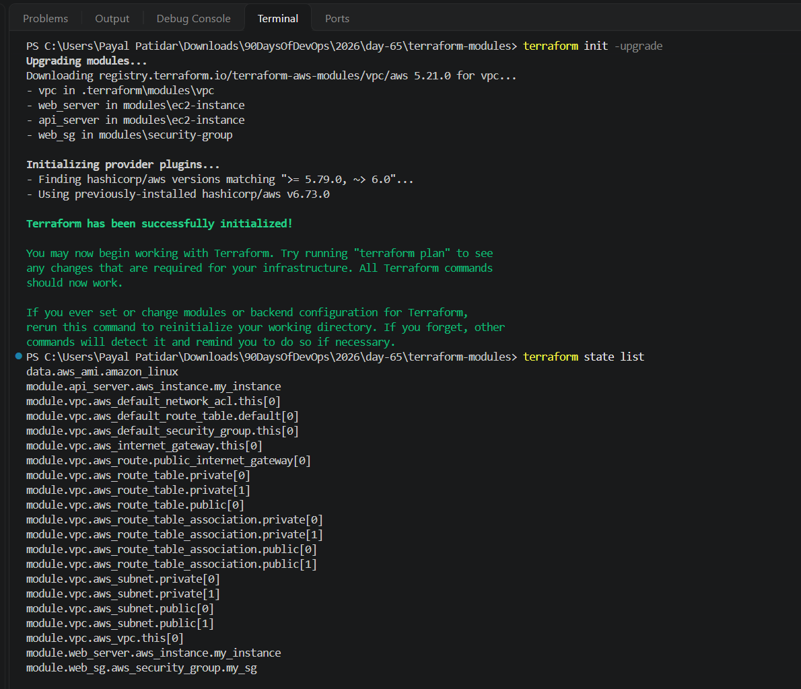

# Day 65 -- Terraform Modules: Build Reusable Infrastructure

## Challenge Tasks
## Task 1: Understand Module Structure

A Terraform module is just a directory with .tf files. Create this structure:

```
terraform-modules/
  main.tf                    # Root module -- calls child modules
  variables.tf               # Root variables
  outputs.tf                 # Root outputs
  providers.tf               # Provider config
  modules/
    ec2-instance/
      main.tf                # EC2 resource definition
      variables.tf           # Module inputs
      outputs.tf             # Module outputs
    security-group/
      main.tf                # Security group resource definition
      variables.tf           # Module inputs
      outputs.tf             # Module outputs
```
Create all the directories and empty files. This is the standard layout every Terraform project follows.

### Q. What is the difference between a "root module" and a "child module"?
Root Module vs Child Module

- Root Module: The main Terraform working directory where we execute Terraform commands like terraform init, plan, and apply. It calls other modules to create and manage infrastructure.

- Child Module: A separate Terraform module called by the root module. It contains reusable infrastructure configurations and accepts input variables from the root module.

Example:
- Root module: terraform-modules/
- Child module: terraform-modules/modules/ec2-instance/

## Task 2: Build a Custom EC2 Module

Create modules/ec2-instance/:

1. variables.tf -- define inputs:

  - ami_id (string)
  - instance_type (string, default: "t2.micro")
  - subnet_id (string)
  - security_group_ids (list of strings)
  - instance_name (string)
  - tags (map of strings, default: {})

2. main.tf -- define the resource:

  - aws_instance using all the variables
  - Merge the Name tag with additional tags(Use merge function)

3. outputs.tf -- expose:

  - instance_id
  - public_ip
  - private_ip

Do NOT apply yet -- just write the module.
  
## Task 3: Build a Custom Security Group Module
Create modules/security-group/:

1. variables.tf -- define inputs:

  - vpc_id (string)
  - sg_name (string)
  - ingress_ports (list of numbers, default: [22, 80])
  - tags (map of strings, default: {})

2. main.tf -- define the resource:

  - aws_security_group in the given VPC
  - Use dynamic "ingress" block to create rules from the ingress_ports list
  - Allow all egress

3. outputs.tf -- expose:

  - sg_id

This is your first time using a dynamic block -- it loops over a list to generate repeated nested blocks.

### 1. What is a Dynamic Block?
A dynamic block in Terraform is used to generate multiple nested configuration blocks dynamically instead of writing each block manually.

It works similarly to a for loop by iterating over a collection such as a list or map.

Without a dynamic block, we need to write three separate ingress blocks.

Syntax:
```hcl
dynamic "block_name" {
  for_each = collection

  content {
    # Configuration for each generated block
  }
}
```

## Task 4: Call Our Modules from Root

In the root main.tf, wire everything together:

1. Create a VPC and subnet directly (or reuse your Day 62 config)
2. Call the security group module:
```
module "web_sg" {
  source        = "./modules/security-group"
  vpc_id        = aws_vpc.main.id
  sg_name       = "terraweek-web-sg"
  ingress_ports = [22, 80, 443]
  tags          = local.common_tags
}
```

3. Call the EC2 module -- deploy two instances with different names using the same module:

```
module "web_server" {
  source             = "./modules/ec2-instance"
  ami_id             = data.aws_ami.amazon_linux.id
  instance_type      = "t2.micro"
  subnet_id          = aws_subnet.public.id
  security_group_ids = [module.web_sg.sg_id]
  instance_name      = "terraweek-web"
  tags               = local.common_tags
}

module "api_server" {
  source             = "./modules/ec2-instance"
  ami_id             = data.aws_ami.amazon_linux.id
  instance_type      = "t2.micro"
  subnet_id          = aws_subnet.public.id
  security_group_ids = [module.web_sg.sg_id]
  instance_name      = "terraweek-api"
  tags               = local.common_tags
}
```

4. Add root outputs that reference module outputs:

```
output "web_server_ip" {
  value = module.web_server.public_ip
}

output "api_server_ip" {
  value = module.api_server.public_ip
}
```

5. Apply

```
terraform init    # Downloads/links the local modules
terraform plan    # Should show all resources from both module calls
terraform apply
```

Verify: Two EC2 instances running, same security group, different names. Check the AWS console.





## Task 5: Use a Public Registry Module

Instead of building your own VPC from scratch, use the official module from the Terraform Registry.

1. Replace your hand-written VPC resources with:

```hcl
module "vpc" {
  source  = "terraform-aws-modules/vpc/aws"
  version = "~> 5.0"

  name = "terraweek-vpc"
  cidr = "10.0.0.0/16"

  azs             = ["ap-south-1a", "ap-south-1b"]
  public_subnets  = ["10.0.1.0/24", "10.0.2.0/24"]
  private_subnets = ["10.0.3.0/24", "10.0.4.0/24"]

  enable_nat_gateway = false
  enable_dns_hostnames = true

  tags = local.common_tags
}
```

2. Update your EC2 and SG module calls to reference module.vpc.vpc_id and module.vpc.public_subnets[0]

3. Run:
```
terraform init     # Downloads the registry module
terraform plan
terraform apply
```

4. Compare: how many resources did the VPC module create vs your hand-written VPC from Day 62?



### Compare: Hand-written VPC vs Registry VPC Module

- Hand-written VPC: Creates only the resources explicitly defined in the Terraform configuration, such as:
- VPC
- Public Subnet
- Internet Gateway
- Route Table
- Route Table Association

Registry VPC Module: Automatically creates and manages additional networking resources, such as:
- VPC
- Public Subnets (2)
- Private Subnets (2)
- Internet Gateway
- Public Route Table
- Private Route Tables
- Public Route Table Associations
- Private Route Table Associations
- Internet Gateway Routes
- Default Network ACL and Security Group management






### Q. Where does Terraform download registry modules to? Check .terraform/modules/.
Terraform downloads Registry modules into the `.terraform/modules/` directory inside the root module's working directory.

- .terraform/modules/ – Stores the downloaded module code.
- modules.json – Contains metadata about the downloaded modules, such as their source and installation directory.
- .terraform/ – A local working directory created by Terraform during initialization.

## Task 6: Module Versioning and Best Practices

1. Pin your registry module version explicitly:

  - version = "5.1.0" -- exact version
  - version = "~> 5.0" -- any 5.x version
  - version = ">= 5.0, < 6.0" -- range

2. Run `terraform init -upgrade` to check for newer versions

3. Check the state to see how modules appear:

`terraform state list`

Notice the module.vpc., module.web_server., module.web_sg. prefixes.



4. Destroy everything:

`terraform destroy`

Document: Write down five module best practices:

  - Always pin versions for registry modules
  - Keep modules focused -- one concern per module
  - Use variables for everything, hardcode nothing
  - Always define outputs so callers can reference resources
  - Add a README.md to every custom module