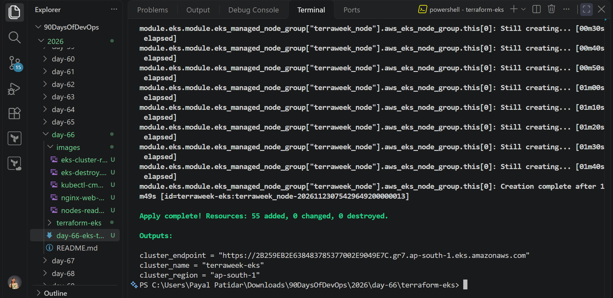
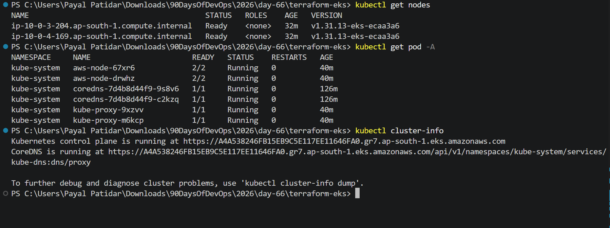
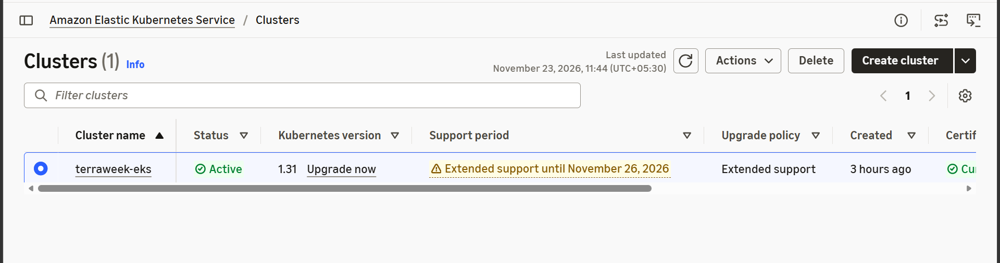
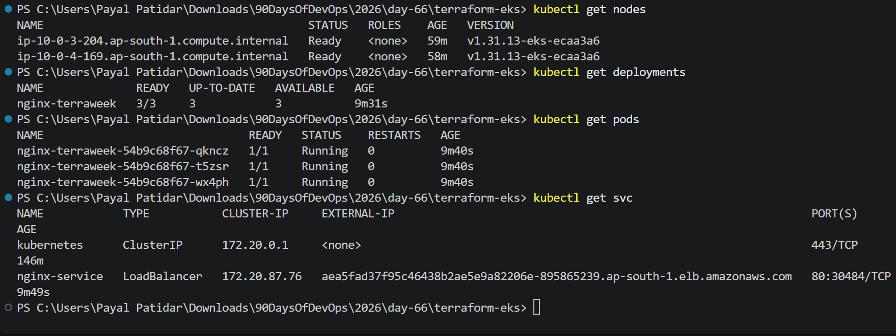
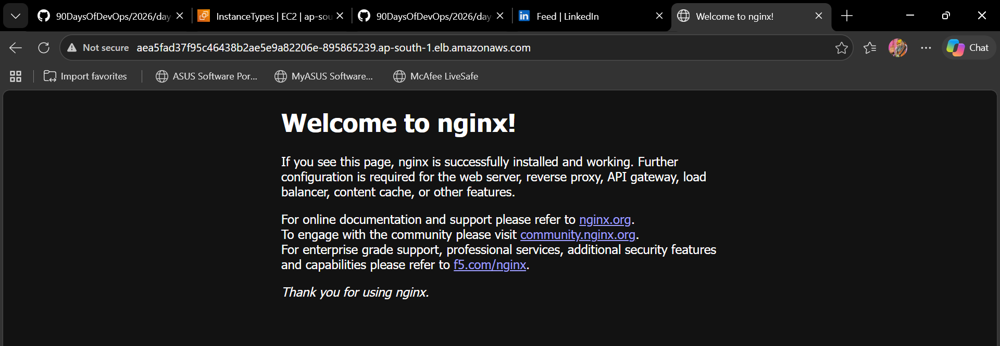
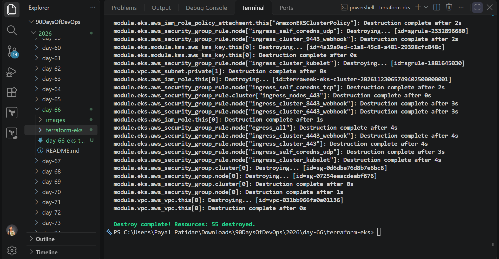

# Day 66 -- Provision an EKS Cluster with Terraform Modules

## Challenge Tasks

## Task 1: Project Setup
Create a new project directory with proper file structure:
```
terraform-eks/
  providers.tf        # Provider and backend config
  vpc.tf              # VPC module call
  eks.tf              # EKS module call
  variables.tf        # All input variables
  outputs.tf          # Cluster outputs
  terraform.tfvars    # Variable values
```

In `providers.tf`:

1. Pin the AWS provider to ~> 5.0
2. Pin the Kubernetes provider (you will need it later)
3. Set your region

In `variables.tf`, define:

- region (string)
- cluster_name (string, default: "terraweek-eks")
- cluster_version (string, default: "1.31")
- node_instance_type (string, default: "t3.medium")
- node_desired_count (number, default: 2)
- vpc_cidr (string, default: "10.0.0.0/16")

Task 2: Create the VPC with Registry Module

EKS requires a VPC with both public and private subnets across multiple availability zones.

In vpc.tf, use the terraform-aws-modules/vpc/aws module:

1. CIDR: var.vpc_cidr
2. At least 2 availability zones
3. 2 public subnets and 2 private subnets
4. Enable NAT gateway (single NAT to save cost): enable_nat_gateway = true, single_nat_gateway = true
5. Enable DNS hostnames: enable_dns_hostnames = true
6. Add the required EKS tags on subnets:
```
public_subnet_tags = {
  "kubernetes.io/role/elb" = 1
}

private_subnet_tags = {
  "kubernetes.io/role/internal-elb" = 1
}
```

Run `terraform init` and `terraform plan` to verify the VPC config before moving on.

### Q. Why does EKS need both public and private subnets? What do the subnet tags do?

EKS uses public and private subnets to separate internet-facing resources from internal workloads. Public subnets typically host internet-facing Load Balancers, while private subnets host worker nodes and application workloads. This improves security by limiting direct internet exposure.

Subnet tags are key-value metadata that help Kubernetes AWS integrations identify suitable subnets for deploying public and internal Load Balancers.

## Task 3: Create the EKS Cluster with Registry Module
In `eks.tf`, use the `terraform-aws-modules/eks/aws` module:

```hcl
module "eks" {
  source  = "terraform-aws-modules/eks/aws"
  version = "~> 20.0"

  cluster_name    = var.cluster_name
  cluster_version = var.cluster_version

  vpc_id     = module.vpc.vpc_id
  subnet_ids = module.vpc.private_subnets

  cluster_endpoint_public_access = true

  eks_managed_node_groups = {
    terraweek_nodes = {
      ami_type       = "AL2_x86_64"
      instance_types = [var.node_instance_type]

      min_size     = 1
      max_size     = 3
      desired_size = var.node_desired_count
    }
  }

  tags = {
    Environment = "dev"
    Project     = "TerraWeek"
    ManagedBy   = "Terraform"
  }
}
```

Run:
```
terraform init      # Download EKS module and its dependencies
terraform plan      # Review -- this will create 30+ resources
```
Review the plan carefully before applying. You should see: EKS cluster, IAM roles, node group, security groups, and more.

## Task 4: Apply and Connect kubectl

1. Apply the config:

`terraform apply`

This will take 10-15 minutes. EKS cluster creation is slow -- be patient.



2. Add outputs in outputs.tf:
```
output "cluster_name" {
  value = module.eks.cluster_name
}

output "cluster_endpoint" {
  value = module.eks.cluster_endpoint
}

output "cluster_region" {
  value = var.region
}
```
3. Update your kubeconfig:

`aws eks update-kubeconfig --name terraweek-eks --region <your-region>`

4. Verify:
    kubectl get nodes
    kubectl get pods -A
    kubectl cluster-info

Verify: Do you see 2 nodes in Ready state? Can you see the kube-system pods running?




## Task 5: Deploy a Workload on the Cluster

Our Terraform-provisioned cluster is live. Deploy something on it.

1. Create a file k8s/nginx-deployment.yaml:

```bash
apiVersion: apps/v1
kind: Deployment
metadata:
  name: nginx-terraweek
  labels:
    app: nginx
spec:
  replicas: 3
  selector:
    matchLabels:
      app: nginx
  template:
    metadata:
      labels:
        app: nginx
    spec:
      containers:
      - name: nginx
        image: nginx:latest
        ports:
        - containerPort: 80
---
apiVersion: v1
kind: Service
metadata:
  name: nginx-service
spec:
  type: LoadBalancer
  selector:
    app: nginx
  ports:
  - port: 80
    targetPort: 80
```

2. Apply:
`kubectl apply -f k8s/nginx-deployment.yaml`

3. Wait for the LoadBalancer to get an external IP:

`kubectl get svc nginx-service -w`

4. Access the Nginx page via the LoadBalancer URL

5. Verify the full picture:
```
kubectl get nodes
kubectl get deployments
kubectl get pods
kubectl get svc
```


Verify: Can you access the Nginx welcome page through the LoadBalancer URL?



## Task 6: Destroy Everything

This is the most important step. EKS clusters cost money. Clean up completely.

1. First, remove the Kubernetes resources (so the AWS LoadBalancer gets deleted):
`kubectl delete -f k8s/nginx-deployment.yaml`

2. Wait for the LoadBalancer to be fully removed (check EC2 > Load Balancers in AWS console)

3. Destroy all Terraform resources:

`terraform destroy`

This will take 10-15 minutes.

4. Verify in the AWS console:
    - EKS clusters: empty
    - EC2 instances: no node group instances
    - VPC: the terraweek VPC should be gone
    - NAT Gateways: deleted
    - Elastic IPs: released

Verify: Is your AWS account completely clean? No leftover resources?

