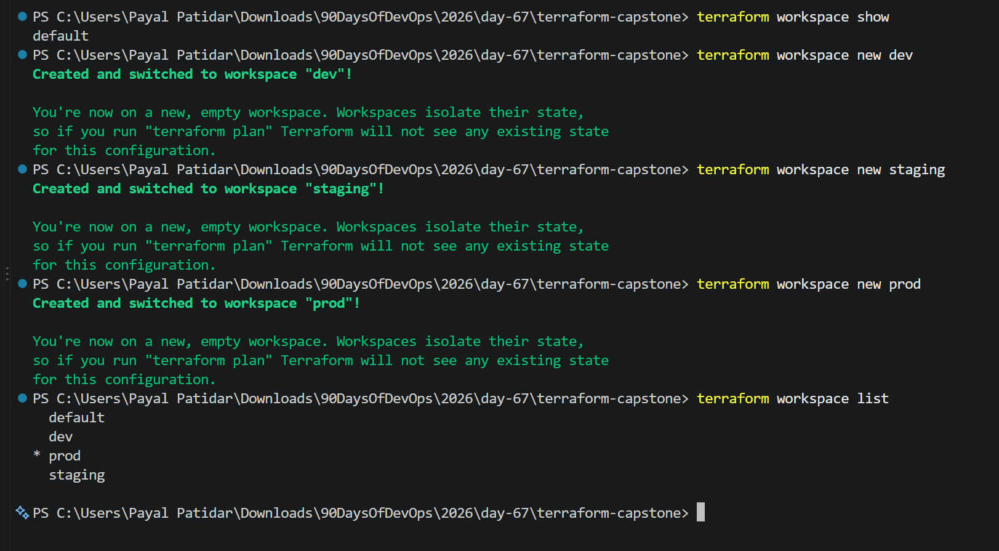
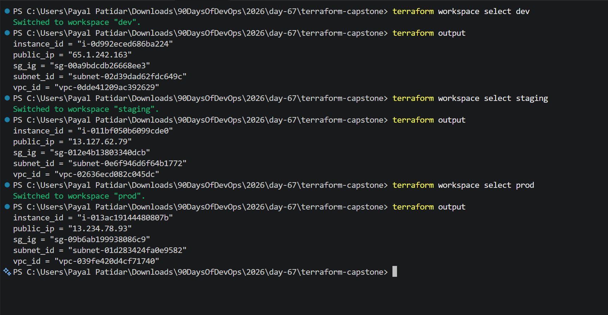
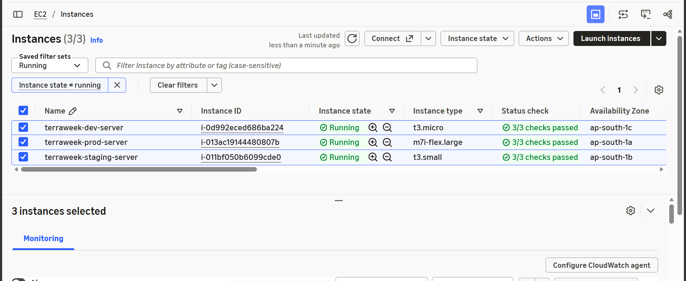
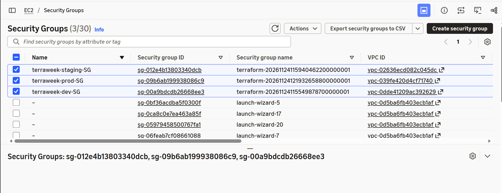

# Day 67 -- TerraWeek Capstone: Multi-Environment Infrastructure with Workspaces and Modules

## Task 1: Learn Terraform Workspaces

1. Terraform Workspaces

Terraform workspace allows us to manages multiple environments using the same Terraform configuration, with seperate state files for each workspace.

They are useful for managing different environments, such as Development, Staging, and Production, without duplicating Terraform code.

In real-world projects, applications often require multiple environments:

- Development (Dev): Used by developers to build and test new features.
- Staging: Used to test the application before deploying it to production.
- Production (Prod): Used to run the application for real users.

With Terraform Workspaces, we can use the same Terraform configuration for all three environments while maintaining separate state files.

2. Creating Terraform Workspaces

```hcl
# See current workspace
terraform workspace show                    # default


terraform workspace new dev
terraform workspace new staging
terraform workspace new prod
```

3. Listing All Workspaces

`terraform workspace list`



4. Selecting a Workspace

To switch between existing workspaces, use:

`terraform workspace select dev`

5. Accessing the Current Workspace

Q. What does `terraform.workspace` return inside a configuration?
Terraform provides a built-in expression called `terraform.workspace` that returns the name of the currently selected workspace.

```hcl
terraform.workspace
```

5. Where Does Terraform Store Workspace State Files?
Terraform maintains a separate state file for each workspace.

For the default local backend, Terraform stores workspace state files inside the following directory structure:
```
terraform-project/
│
├── main.tf
├── variables.tf
├── outputs.tf
│
└── terraform.tfstate.d/
    │
    ├── dev/
    │   └── terraform.tfstate
    │
    ├── staging/
    │   └── terraform.tfstate
    │
    └── prod/
        └── terraform.tfstate
```


7. Terraform Workspaces vs Separate Directories

Q. How is this different from using separate directories per environment?
When using separate directories, we create an individual Terraform configuration for each environment, such as Dev, Staging, and Production. This can lead to code duplication because we need to maintain similar configuration files in multiple directories.

With Terraform Workspaces, we use a single Terraform configuration for all environments. Each workspace maintains its own separate state file, allowing us to manage multiple environments without duplicating Terraform code.


## Task 2: Set Up the Project Structure
Create this layout:
```
terraweek-capstone/
  main.tf                   # Root module -- calls child modules
  variables.tf              # Root variables
  outputs.tf                # Root outputs
  providers.tf              # AWS provider and backend
  locals.tf                 # Local values using workspace
  dev.tfvars                # Dev environment values
  staging.tfvars            # Staging environment values
  prod.tfvars               # Prod environment values
  .gitignore                # Ignore state, .terraform, tfvars with secrets
  modules/
    vpc/
      main.tf
      variables.tf
      outputs.tf
    security-group/
      main.tf
      variables.tf
      outputs.tf
    ec2-instance/
      main.tf
      variables.tf
      outputs.tf

```
Q. Why is this file structure considered best practice?
This structure makes Terraform projects cleaner, modular, reusable, easier to maintain, and suitable for real-world infrastructure management.

## Task 3: Build the Custom Modules

Create three focused modules:

Module 1: modules/vpc/

- Input: cidr, public_subnet_cidr, environment, project_name
- Resources: VPC, public subnet, internet gateway, route table, route table association
- Output: vpc_id, subnet_id
- All resources tagged with environment and project name

Module 2: modules/security-group/

- Input: vpc_id, ingress_ports, environment, project_name
- Resources: Security group with dynamic ingress rules, allow all egress
- Output: sg_id

Module 3: modules/ec2-instance/

- Input: ami_id, instance_type, subnet_id, security_group_ids, environment, project_name
- Resources: EC2 instance with tags
- Output: instance_id, public_ip

## Task 4: Wire It All Together with Workspace-Aware Config

In the root module, use terraform.workspace to drive environment-specific behavior.

locals.tf:

```hcl
locals {
  environment = terraform.workspace
  name_prefix = "${var.project_name}-${local.environment}"

  common_tags = {
    Project     = var.project_name
    Environment = local.environment
    ManagedBy   = "Terraform"
    Workspace   = terraform.workspace
  }
}
```

variables.tf:
```hcl
variable "project_name" {
  type    = string
  default = "terraweek"
}

variable "vpc_cidr" {
  type = string
}

variable "subnet_cidr" {
  type = string
}

variable "instance_type" {
  type = string
}

variable "ingress_ports" {
  type    = list(number)
  default = [22, 80]
}
```

main.tf -- call all three modules, passing workspace-aware names and variables.

```hcl
module "vpc" {
    source = "./modules/vpc"

    vpc_cidr = var.vpc_cidr
    subnet_cidr = var.subnet_cidr
    environment = local.environment
    project_name = var.project_name
}

module "sg" {
    source = "./modules/security-group"

    vpc_id = module.vpc.vpc_id
    ingress_ports = var.ingress_ports

    environment = local.environment
    project_name = var.project_name

}

module "ec2" {
    source = "./modules/ec2-instance"

    instance_type = var.instance_type
    ami_id = data.aws_ami.amazon_linux.id
    subnet_id = module.vpc.subnet_id
    security_group_ids = [module.sg.sg_ig]

    environment = local.environment
    project_name = var.project_name
    
}
```

Environment-specific tfvars:

`dev.tfvars:`

`vpc_cidr      = "10.0.0.0/16"
subnet_cidr   = "10.0.1.0/24"
instance_type = "t3.micro"
ingress_ports = [22, 80]
`

`staging.tfvars:`

`vpc_cidr      = "10.1.0.0/16"
subnet_cidr   = "10.1.1.0/24"
instance_type = "t3.small"
ingress_ports = [22, 80, 443]
`

`prod.tfvars:`

`vpc_cidr      = "10.2.0.0/16"
subnet_cidr   = "10.2.1.0/24"
instance_type = "m7i-flex.large"
ingress_ports = [80, 443]
`

Notice: dev allows SSH, prod does not. Different CIDRs prevent overlap. Instance types scale up per environment.

## Task 5: Deploy All Three Environments

Deploy each environment using its workspace and tfvars file:

Dev:
```hcl
terraform workspace select dev
terraform plan -var-file="dev.tfvars"
terraform apply -var-file="dev.tfvars"
```

Staging:
```hcl
terraform workspace select staging
terraform plan -var-file="staging.tfvars"
terraform apply -var-file="staging.tfvars"
```

Prod:
```hcl
terraform workspace select prod
terraform plan -var-file="prod.tfvars"
terraform apply -var-file="prod.tfvars"
```

After all three are deployed, verify:

```hcl
# Check each workspace's resources
terraform workspace select dev && terraform output
terraform workspace select staging && terraform output
terraform workspace select prod && terraform output
```



Go to the AWS console and verify:

Verify: Are all three environments completely isolated from each other?

Three EC2 instances with different instance types
Different Name tags per environment: terraweek-dev-server, terraweek-staging-server, terraweek-prod-server





Three separate VPCs with different CIDR ranges


## Task 6: Destroy All Environments

Clean up all three environments in reverse order:
```hcl
terraform workspace select prod
terraform destroy -var-file="prod.tfvars"

terraform workspace select staging
terraform destroy -var-file="staging.tfvars"

terraform workspace select dev
terraform destroy -var-file="dev.tfvars"
Verify in the AWS console -- all VPCs, instances, security groups, and gateways should be gone.
```

Delete the workspaces:
```hcl
terraform workspace select default
terraform workspace delete dev
terraform workspace delete staging
terraform workspace delete prod
Verify: Is your AWS account completely clean?
```

# Document Best Practices

1. File structure -- separate files for providers, variables, outputs, main, locals
2. State management -- always use remote backend, enable locking, enable versioning
3. Variables -- never hardcode, use tfvars per environment, validate with validation blocks
4. Modules -- one concern per module, always define inputs/outputs, pin registry module versions
5. Workspaces -- use for environment isolation, reference terraform.workspace in configs
6. Security -- .gitignore for state and tfvars, encrypt state at rest, restrict backend access
7. Commands -- always run plan before apply, use fmt and validate before committing
8. Tagging -- tag every resource with project, environment, and managed-by
9. Naming -- consistent prefix pattern: <project>-<environment>-<resource>
10. Cleanup -- always terraform destroy non-production environments when not in use